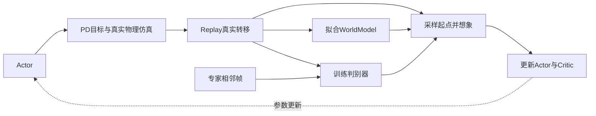
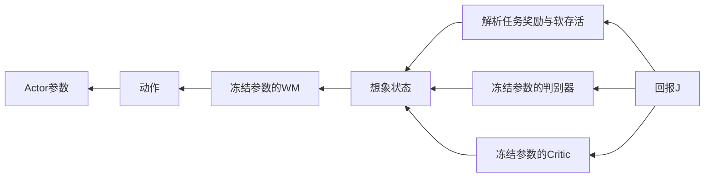

# AMP 软件架构：2026-10-30 代码快照

当前步行主线是 `amp_train.py`：真实物理采集经验，世界模型学习动力学，Actor 在模型内想象并沿奖励反向传播。AMP 指 Adversarial Motion Prior；`--amp false` 只关闭 MLP 的 bfloat16 混合精度。新训练随机初始化四个网络，不依赖教师策略。

下表尺寸已用 `runs/amp_walk_best/best_0042000.pt` 的权重核对。所有网络前都有运行均值/方差归一化；它们是统计缓冲区，不是额外学习网络。

| 模块 | 输入 → 隐藏层 → 输出 | 职责与训练信号 |
|---|---|---|
| Actor / `CommandActor` | **384 → 512 → 256 → 128 → 29**，ELU | 4帧观测→关节目标；最大化想象回报，输出 `3*tanh(raw/3)` |
| WorldModel | **307 → 2048 → 2048 → 2048 → 70**，SiLU | 状态特征245＋动作29＋ξ33→状态增量；拟合真实连续转移 |
| Critic | **310 → 256 → 128 → 1**，ELU | 特征245＋命令3＋ξ33＋上个动作29→未来价值；拟合想象轨迹的 λ-return |
| AMP Discriminator | **390 → 1024 → 512 → 256 → 1**，ReLU | 两帧各195维身体特征→风格分数；专家目标+1、策略目标−1，加梯度惩罚 |



真实物理由 `mjlab` / MuJoCo Warp 执行，单物理步5ms，每4步控制一次，即50Hz；碰撞与接触由物理求解器处理。WM 是可微 MLP 替身，只预测动力学增量，再解析积分；奖励、观测、运动学和终止函数仍是代码计算，没有学习奖励头，也不输出接触力。

状态与观测的几个数字不能混用：

| 表示 | 内容 |
|---|---|
| 状态71 | 根位置3、四元数4、关节角29、根线速度3、角速度3、关节速度29；内部旋转转为矩阵 |
| 状态特征245 | 高度1、去航向旋转6、线速度3、局部角速度3、关节角/速度各29、29个非根身体相对位置/线速度各87 |
| 状态增量70 | 位置3、旋转轴角3、线速度3、角速度3、关节角/速度各29 |
| 单帧观测96 | gyro3＋gravity3＋command3＋`q−q0+bias`29＋qd29＋上个干净动作29；Actor看4帧，共384 |
| ξ33 | 摩擦1＋编码器偏置29＋质心偏移3；Actor只经观测间接感受它们 |
| AMP特征195 | 13个身体×（躯干相对位置3＋相对朝向6＋自身坐标系线速度3＋角速度3） |

`clean_action` 是Actor输出；采样时加探索噪声、裁剪后得到 `executed_action`。物理目标为 `q0 + action_scale*executed_action − enc_bias`，不是直接力矩。Replay 用执行动作拟合WM，观测历史和动作变化惩罚用干净动作，避免混淆传感器历史与探索噪声。

训练参数以 [24GB启动脚本](../scripts/train_amp_walk_24gb.sh) 的 `train` 模式为准，不能直接套用 dataclass 默认值：

| 参数 | 当前预设含义 |
|---|---|
| 4096 / buffer_steps=1000 | 每次采集4096条转移，保存每环境最近1000步 |
| H=32 / K=8 / history=4 | Actor想象未来32步（0.64s）/ WM拟合连续8步 / Actor回看4帧 |
| UTD=0.4 | 每5次并行采集约2轮更新；不是每条转移更新0.4次 |
| WM / D / Actor批量 | WM：10×512；判别器：2×512；Actor：256条想象轨迹 |
| 命令 | 前进速度0.2–0.8m/s，侧向与转向为0；10%采样为站立 |

```text
启动或恢复后：collect 64次，填充新Replay
每个外层iteration：
  调整学习率；collect一次；credit += 0.4
  while credit >= 1:
    credit -= 1
    update_wm()                  # 连续K步误差，更新WM
    update_prior()               # 真实策略对/专家对，更新D
    if iteration >= 500:
      update_actor()             # 先优化H步可微回报，再在内部调用update_critic
                                 # Critic用同批detach轨迹回归，5×4小批
```

所以 `wm_only_iters=500` 阶段仍训练判别器。Actor目标是折扣奖励和加末端价值 `γ^H V(s_H)`，生存权重逐步衰减。下图表示梯度回传方向，轨迹展开H次：



“冻结”指临时设置这些模块参数 `requires_grad=False`，保留对输入的导数；不是 `no_grad`。Actor步只改Actor权重，下一训练阶段恢复其他模块更新。Critic训练使用已detach的状态、奖励和目标，不再回传到Actor。

专家有两个用途：判别器正样本仅选 `walk_forward_` 的2段，50%原速＋50%按0.4/0.6/0.8倍时间缩放；参考状态初始化（RSI）仍从完整11段库采样，50%重置用RSI、另50%用站姿。专家不提供逐时刻追踪目标。判别器不输入命令；命令只在奖励外部乘门控 `clamp((norm(vxy)+0.5*abs(wz))/0.2,0,1)`，站立时风格奖励归零。

总奖励为 `0.75*task + 0.25*style`。任务中的速度、直立、动作变化、关节限制各项已经乘 `dt=0.02`；风格奖励是每控制步 `0.1*max(0,1−0.25*(D−1)^2)` 再乘门控，不能再统一乘dt。真实环境按硬跌倒条件或20s超时重置；想象使用连续软终止概率。`AMPEnv.step()` 返回重置前后继状态，Replay和判别器因此不会把重置跳变当作动作转移。

播放只运行Actor及观测历史，然后送PD/物理仿真；没有每帧搜索动作的在线MPC。检查点保存四网络、归一化统计、优化器、配置、计数和随机数状态；不保存Replay或物理现场，恢复时重新重置并采集。

训练外围还有独立的验证和运行管理层：`amp_eval.py` 用物理仿真评估固定命令，`render_amp_walk.py` 保存视频与状态轨迹，`amp_gait_metrics.py` 分析抬脚与相位，`evaluate_amp_contacts.py` 记录求解器接触。`supervise_amp_training.py` 管理训练进程、续训与异常状态，`watch_amp_evaluation.py` 发现检查点后运行评估。它们不参与Actor的反向传播；实验配置决定课程变化，推荐检查点依据独立评估和视频选择。

每个运行目录中的 `config.json` 是实际配置，`initialization.json` 记录初始化和课程来源，`log.jsonl` 与 `tb/` 保存训练指标，`ckpt_*.pt` 与 `last.pt` 保存学习状态。TensorBoard评审目录中的拼接曲线、验收点是另外导出的视图；原始证据仍在各运行目录。

| 日志字段 | 如何理解 |
|---|---|
| `sim_*`, `linear_error`, `yaw_error` | 真实仿真奖励、平面速度误差、偏航误差 |
| `wm_err1`, `wm_errk` | 归一化状态预测误差，不能直接读成米或弧度 |
| `policy_score`, `expert_score`, `discriminator_loss` | 真假判别分数与分类损失；梯度惩罚另列 |
| `imagined_return`, `imagined_survival`, `critic_loss` | 模型内回报、软存活与价值拟合，不等于真实评估 |
| `episode_seconds`, `episode_fall_fraction` | 已结束真实回合的长度、跌倒比例；没有结束回合时均值函数返回0 |

所选42k模型是本项目检查点分阶段续训的结果，最终参数并非全程固定。其foot-slip权重为0；当前新增的高速偏航/落脚/穿透细化及低速self-anchor也未启用。self-anchor若开启，是冻结自身旧检查点Actor作低速动作正则。`amp_contact_reward.py` 的接触项是解析几何/运动学代理；[evaluate_amp_contacts.py](../code/scripts/evaluate_amp_contacts.py) 才测量真实GPU求解器接触，二者不可互相代称。

仓库其他入口：`train.py` 是带未来参考动作目标的模型内反向传播追踪；`ppo.py` 是真实仿真PPO；`ppo_wm.py` 在无梯度WM轨迹上做PPO；`velocity.py` 给原追踪策略增加速度编码器、共用32维潜变量和解码器，不是此AMP Actor。

建议阅读顺序（下列模块位于 `code/supermimic/`）：`amp_train.AMPTrainer.run/collect` → `amp_env.AMPEnv.step` → `amp_task.AMPTask.observation/reward/termination` → `amp_replay.AMPReplay` → `amp_train.update_wm/update_prior/update_actor/update_critic` → `networks.WorldModel`、`amp_networks.CommandActor`、`amp_prior.AMPFeatureExtractor/AMPPrior`。配置来源与训练阶段记录见 [training_config.json](../runs/amp_walk_best/training_config.json) 和 [initialization.json](../runs/amp_walk_best/initialization.json)。

修改时按职责落点：命令分布/预算先用启动脚本的命令行参数覆盖，要改默认预设时再编辑脚本；改观测或任务奖励看 `amp_task.py`（观测维度变化同步Actor）；改策略结构看 `amp_networks.py`；改动力学看 `networks.py` 与 `amp_train.update_wm`；改风格特征/判别器看 `amp_prior.py`，改专家采样看 `amp_augmentation.py`；改真实控制/重置看 `amp_env.py`。先核对维度和旧检查点兼容性，再用对应 `code/scripts/dev/test_amp_*.py` 验证改动。
